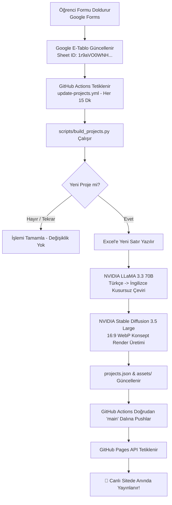

# 🛠️ IUS Engineering Club — Geliştirici Kılavuzu & Mimari Prensipler (Developer Guide)

> **DİKKAT:** Bu projeye katkıda bulunmadan, kod yazmadan veya değişiklik yapmadan önce lütfen bu belgenin tamamını dikkatle okuyunuz. Projenin üretim standartlarını, otomasyon hattını ve **kesinlikle yapılmaması gereken kuralları** içerir.

---

## 📌 İçindekiler
1. [Projenin Amacı ve Vizyonu](#1-projenin-amacı-ve-vizyonu)
2. [Teknoloji Yığını ve Felsefesi](#2-teknoloji-yığını-ve-felsefesi)
3. [Dizin Yapısı ve Sorumluluk Alanları](#3-dizin-yapısı-ve-sorumluluk-alanları)
4. [Tek Gerçek Kaynağı (Single Source of Truth - SSOT)](#4-tek-gerçek-kaynağı-single-source-of-truth---ssot)
5. [Otomasyon Hattı (Google Forms -> AI -> Canlı Yayın)](#5-otomasyon-hattı-google-forms---ai---canlı-yayın)
6. [🚫 KESİNLİKLE YAPILMAMASI GEREKENLER (Strict Rules)](#6--kesinlikle-yapilmamasi-gerekenler-strict-rules)
7. [Yerel Ortamda Çalıştırma ve Test](#7-yerel-ortamda-çalıştırma-ve-test)
8. [Mobil ve Erişilebilirlik Standartları](#8-mobil-ve-erişilebilirlik-standartları)
9. [Yeni Proje Girişi Süreci](#9-yeni-proje-girişi-süreci)

---

## 1. Projenin Amacı ve Vizyonu

Bu depo, **Uluslararası Saraybosna Üniversitesi (IUS)** Mühendislik ve Doğa Bilimleri Fakültesi (**FENS**) bünyesindeki **IUS Engineering Club (IEC)** tarafından yürütülen inovasyon portfolyosunu barındırır.

Amacı:
- Öğrencilerin donanım, IoT, yazılım ve yapay zeka projelerini şeffaf, etkileyici ve modern bir platformda sergilemek.
- Proje fikirlerinin sponsorlar, mentörler ve üniversite yönetimi tarafından kolayca incelenmesini sağlamak.
- Google Form üzerinden toplanan proje önerilerini **tamamen otonom** olarak derleyip, AI ile çevirip ve görselleştirip canlı yayına almak.

🌐 **Canlı Site:** [https://hasankaan28.github.io/ius-engineering-events-site/projects/](https://hasankaan28.github.io/ius-engineering-events-site/projects/)

---

## 2. Teknoloji Yığını ve Felsefesi

Proje, **"Zero-Dependency / Maximum Performance"** (Sıfır Dış Bağımlılık, Maksimum Performans) felsefesiyle inşa edilmiştir:

| Katman | Teknoloji | Neden Tercih Edildi? |
| :--- | :--- | :--- |
| **Arayüz İskeleti** | Semantik HTML5 | WCAG 2.2 AA erişilebilirliği, kusursuz SEO, JSON-LD yapısal veri. |
| **Stil & Tasarım** | Saf Vanilla CSS | Sıfır bundle boyutu, donanım hızlandırmalı geçişler, CSS Custom Properties (temalar). |
| **Uygulama Mantığı** | Saf Vanilla JavaScript (ES6+) | Framework yükü (React/Vue/Angular) olmadan 60 FPS akıcı render, Web Audio API ses sentezleme. |
| **Veri Boru Hattı** | Python 3.12 (`openpyxl`, `Pillow`, `requests`) | Katı şema doğrulaması, görsel sıkıştırma ve WebP dönüştürme. |
| **Yapay Zeka** | NVIDIA NIM API (`meta/llama-3.3-70b-instruct`, `stabilityai/stable-diffusion-3.5-large`) | Otomatik profesyonel İngilizce çeviri ve 16:9 sinematik konsept görseli üretimi. |
| **CI/CD & Dağıtım** | GitHub Actions & GitHub Pages | Form doldurulduğu anda dakikalar içinde canlıya doğrudan derleme ve dağıtım. |

---

## 3. Dizin Yapısı ve Sorumluluk Alanları

```plaintext
ius-engineering-events-site/
├── .github/
│   └── workflows/
│       └── update-projects.yml     # 15 dk'da bir veya tetiklemeyle çalışan otonom CI/CD hattı
├── assets/                         # Kök dizin varlıkları & 16:9 WebP konsept renderları
├── data/
│   ├── projects.json               # Kök veri: Tek gerçek kaynağı (Single Source of Truth)
│   ├── projects.xlsx               # Proje verilerinin Excel tablosu
│   ├── translations_report.md      # AI çeviri kalite ve tutarlılık raporu
│   └── image_prompts.json          # AI görsel prompt kayıtları
├── projects/                       # ANA UYGULAMA DİZİNİ (Kullanıcıların gezdiği vitrin)
│   ├── index.html                  # Vitrin HTML iskeleti (Tek sayfa, dialoglar, çekmece)
│   ├── style.css                   # Glassmorphism, 5 palet teması, mobil duyarlı stil motoru
│   ├── app.js                      # Dinamik kart render, ses sentezleme, i18n, modal yönetimi
│   ├── data/                       # Vitrinin doğrudan fetch ettiği projects.json ve projects.xlsx
│   └── assets/                     # Vitrin görsel varlıkları (aynı WebP dosyalarıyla senkron)
├── scripts/
│   ├── build_projects.py           # Excel/Google Sheet okuyan, doğrulayan, AI çağrılarını yapan motor
│   ├── image_style.txt             # Kararlı görsel stili için append edilen prompt kuralı
│   └── README.md                   # Excel 52 sütun eşleme rehberi
├── index.html                      # Kök yönlendirici (/projects/ sayfasına pürüzsüz yönlendirme)
├── style.css                       # Kök stil sayfası (Geriye dönük uyumluluk)
├── requirements.txt                # Python bağımlılıkları (openpyxl, pillow, requests)
├── DEVELOPER_GUIDE.md              # Bu kılavuz
└── README.md                       # GitHub depo ana tanıtım sayfası
```

---

## 4. Tek Gerçek Kaynağı (Single Source of Truth - SSOT)

Bu projede tek bir kural vardır: **TÜM PROJELER VERİDEN GELİR.**

- Projelerin verisi **`data/projects.json`** ve **`projects/data/projects.json`** dosyalarında tutulur.
- HTML dosyalarında (`index.html` veya `projects/index.html`) **hiçbir proje kartı elle yazılmaz**.
- Web uygulaması (`app.js`), sayfa yüklendiğinde `data/projects.json` dosyasını `fetch()` ederek kartları dinamik, semantik `<article>` blokları olarak üretir.
- Veri şeması:
  - `id`: Benzersiz URL slug (`powerbank-station`, `dining-app` vb.)
  - `title`: `{ tr: "...", en: "..." }`
  - `tagline`: `{ tr: "...", en: "..." }`
  - `category`: `{ tr: "...", en: "..." }`
  - `difficulty`: `1` - `5` arası tam sayı
  - `specs`: `[{ label: { tr, en }, value: { tr, en } }]`
  - `palette`: 5 resmi temadan biri (`gothic-noir`, `cobalt-sky`, `chili-spice`, `ink-wash`, `urban-loft`)
  - `image`: `./assets/<slug>.webp` yolu.

---

## 5. Otomasyon Hattı (Google Forms -> AI -> Canlı Yayın)

Herhangi bir mühendislik öğrencisi veya kulüp üyesi başvuru formunu doldurduğunda ne olur?



---

## 6. 🚫 KESİNLİKLE YAPILMAMASI GEREKENLER (Strict Rules)

Projeyle çalışırken aşağıdaki kuralları çiğnemek sistemin bozulmasına, canlı yayının durmasına veya veri kaybına yol açar:

### ❌ 1. Projeleri HTML Dosyalarına Asla Elle Kodlamayın (No Hardcoded Projects)
- `projects/index.html` içerisine `<article class="project-stage">...` şeklinde sabit proje kartı eklemeyiniz.
- Yeni bir proje eklemek istiyorsanız Google Formu doldurun veya `data/projects.xlsx` dosyasına yeni bir satır ekleyip pipeline'ı çalıştırın.

### ❌ 2. TailwindCSS, Bootstrap veya Harici UI Kütüphaneleri Eklemeyin
- Bu projede **TailwindCSS, Bootstrap, Material-UI, FontAwesome CDN** vb. harici CSS kütüphaneleri KULLANILMAZ.
- Tüm stiller `projects/style.css` içindeki CSS değişkenleri (`--accent-gold`, `--bg-surface`, `--radius-lg` vb.) ile hazırlanmıştır.
- Yeni bileşen eklerken projenin tasarım tokens sistemine uyunuz.

### ❌ 3. Arayüz Metinlerini Asla Sabit Dilde Yazmayın (Always Use `I18N`)
- JavaScript veya HTML içinde metin yazarken doğrudan Türkçe veya doğrudan İngilizce metin gömmeyin.
- Sitede çift dil desteği (Varsayılan: `EN`, Seçenek: `TR`) bulunmaktadır.
- Yeni bir metin ekliyorsanız:
  1. `projects/app.js` içerisindeki `I18N.tr` ve `I18N.en` sözlüklerine ekleyin.
  2. HTML elemanına `data-i18n="anahtar_adi"` verin.
  3. Teknik terimler için `SPEC_TRANSLATIONS` tablosunu güncelleyin.

### ❌ 4. Sıkıştırılmamış Ham PNG/JPG Yüklemeyin
- `assets/` klasörüne doğrudan 5-10 MB'lık ham PNG veya JPEG atmayın.
- Projedeki tüm görseller:
  - **Format:** WebP
  - **En-Boy Oranı:** 16:9
  - **Boyutlar:** 1376×768 (ana görsel) ve 688×384 (küçük görsel: `<slug>-sm.webp`)
  - **Kalite:** 85% sıkıştırma.

### ❌ 5. API Anahtarlarını Repoya Commit Etmeyin
- `NVIDIA_API_KEY` veya herhangi bir gizli anahtarı kesinlikle koda, betiklere veya git commit'lerine yazmayın.
- Bu anahtar sadece GitHub Repository Secrets (`Settings -> Secrets and variables -> Actions`) içinde bulunur.

### ❌ 6. Otomasyon Commit Mesajlarına `[skip ci]` Eklemeyin
- GitHub Pages, commit mesajında `[skip ci]` veya `[ci skip]` gördüğünde **canlı site derlemesini iptal eder**.
- Otomasyon commit'leri `[skip ci]` İÇERMEMELİDİR; böylece her yeni proje commit edildiğinde GitHub Pages otomatik olarak yeni versiyonu yayınlar.

### ❌ 7. Sabit Yükseklik (`100vh`) ve Taşmaya Neden Olacak Sabit Pikseller Kullanmayın
- Mobilde adres çubuğu açılıp kapandığında içeriğin kesilmemesi için `100vh` yerine `100dvh` kullanılmalıdır.
- Mobil ekranlarda taşmaları önlemek için `overflow-x: hidden; max-width: 100vw;` kuralı korunmalıdır.
- Dokunmatik butonlar en az **44×44px** olmalıdır.
- Çentikli telefonlar için `env(safe-area-inset-bottom)` koruması çiğnenmemelidir.

### ❌ 8. Git Kimliğini Değiştirmeyin
- Projedeki tüm commit'ler doğrulanmış `HasanKaan28 <ufukkarabulut35@gmail.com>` kimliğiyle atılmalıdır. Git yapılandırmanızı bozmayınız.

---

## 7. Yerel Ortamda Çalıştırma ve Test

### Yerel Sunucuyu Başlatma
Projede derleme adımı (build step) gerektiren bir framework yoktur. Doğrudan bir statik sunucuyla çalıştırabilirsiniz:

```powershell
# Proje kök dizininde yerel sunucu başlatın:
python -m http.server 8099
```
Tarayıcınızda açın:
- **Projeler Vitrini:** [http://localhost:8099/projects/](http://localhost:8099/projects/)
- **Kök Yönlendirici:** [http://localhost:8099/](http://localhost:8099/)

### Python Otomasyon Pipeline'ını Simüle Etme (Dry-Run)
Veri şemasında veya scriptlerde değişiklik yaptıktan sonra dış API çağrısı yapmadan doğrulamak için:

```powershell
python scripts/build_projects.py --dry-run
```

### JavaScript Sözdizimi Kontrolü
```powershell
node --check projects/app.js
node --check app.js
```

---

## 8. Mobil ve Erişilebilirlik Standartları

- **Görsel Öncelikli Akış (Visual-First Story Layout):** Mobil ekranlarda (`<= 768px`) projenin 16:9 konsept görseli en üstte (`order: -1`) yer alır; kullanıcı hemen render'ı görür, ardından detayları okur.
- **Auto-Zoom Koruması:** iOS Safari'nin input odaklanmasında ekrana yakınlaşmasını engellemek için tüm mobil form elemanlarında `font-size: 16px` kuralı korunmalıdır.
- **Pil & Performans:** Dokunmatik cihazlarda (`hover: none and pointer: coarse`) 3D tilt fare eğimi devre dışı bırakılır; GPU gereksiz yere yorulmaz.
- **Erişilebilirlik:** Tüm butonlarda `aria-label`, dialoglarda `role="dialog"` ve `aria-modal="true"`, görsellerde anlamlı `alt` etiketleri zorunludur.

---

## 9. Yeni Proje Girişi Süreci

Yeni bir proje eklemenin **3 yolu** vardır:

1. **Google Form Üzerinden (Önerilen & Otomatik):**
   - Formu doldurun: [IUS Engineering Club Fikir Formu](https://docs.google.com/forms/d/e/1FAIpQLSeZ3RHZbw2BMaboNw4yS0xLALOv4KXzXdAg1gyF-434rMP5Ew/viewform)
   - 15 dakika içinde GitHub Actions formu çeker, projeyi İngilizceye çevirir, yapay zeka ile görselini üretir ve canlıya alır.

2. **Excel Dosyası Üzerinden (`data/projects.xlsx`):**
   - Excel dosyasını açıp yeni bir satır ekleyin (Sütun kuralları için [scripts/README.md](scripts/README.md) dosyasına bakın).
   - Değişikliği `main` dalına pushlayın. GitHub Actions otomatik olarak derleyecektir.

3. **Manuel Tetikleme (GitHub Actions UI):**
   - GitHub deposunda **Actions** sekmesine gidin.
   - **Update Projects Data & Concept Renders** iş akışını seçip **Run workflow** butonuna tıklayın.

---

*IUS Engineering Club — International University of Sarajevo*  
*Faculty of Engineering and Natural Sciences (FENS)*
