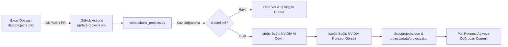

# 📊 IUS Engineering Club — Excel Veri Akışı ve Otomasyon Sistemi

Bu doküman, proje verilerinin Excel (`data/projects.xlsx`) üzerinden yönetilmesi, GitHub Actions ile otomatik olarak doğrulanıp `projects.json` dosyasına dönüştürülmesi ve eksik içerikler için NVIDIA AI servisleri (çeviri ve konsept görseli üretimi) ile zenginleştirilmesini açıklar.

---

## 🎯 Temel Akış Mimarisi



---

## 📑 Excel Sütunları ve JSON Alan Eşleşmesi

Excel şablonunda her satır **bir projeyi**, her sütun ise `projects.json` içindeki bir veri alanını temsil eder:

| Sütun Adı (Excel) | JSON Karşılığı | Tip / Format | Açıklama & Kurallar |
| :--- | :--- | :--- | :--- |
| `id` | `id` | Metin (Slug) | **ZORUNLU & BENZERSİZ.** Yalnızca küçük harf, rakam, tire (`-`) ve alt çizgi (`_`). Örn: `powerbank-station`. |
| `sheet_id` | `sheet_id` | Tamsayı | Proje sıra numarası (1, 2, 3...). |
| `is_flagship` | `is_flagship` | Boolean | `TRUE` veya `FALSE`. Öne çıkan ana projeler için. |
| `featured` | `featured` | Boolean | `TRUE` veya `FALSE`. Vitrin listelemesi için. |
| `difficulty` | `difficulty` | Tamsayı (1-5) | **ZORUNLU.** 1 ile 5 arasında olmalıdır. Karttaki zorluk noktalarını belirler. |
| `category_tr` | `category.tr` | Metin | Projenin Türkçe kategori adı. |
| `category_en` | `category.en` | Metin | Projenin İngilizce kategori adı (boşsa AI tarafından çevrilebilir). |
| `badge_tr` | `badge.tr` | Metin | Türkçe rozet (örn: "Proje Fikri", "Önerilen Etkinlik"). |
| `badge_en` | `badge.en` | Metin | İngilizce rozet (örn: "Project Idea"). |
| `status_tr` | `status.tr` | Metin | Proje aşaması (örn: "Öneri", "Planlanan", "Prototip", "Aktif"). |
| `status_en` | `status.en` | Metin | Proje aşaması İngilizce (örn: "Proposal"). |
| `sponsor_status` | `sponsor_status` | Metin / Boş | **Kısıtlı Değer:** Yalnızca boş (`null`), `Sponsor Aranıyor` veya `Sponsor Gerekmiyor` olabilir. |
| `joinUrl` | `joinUrl` | URL / Boş | Başvuru veya katılım bağlantısı. |
| `title_tr` | `title.tr` | Metin | **ZORUNLU.** Projenin Türkçe resmi başlığı. |
| `title_en` | `title.en` | Metin | Projenin İngilizce başlığı. |
| `tagline_tr` | `tagline.tr` | Metin | Türkçe kısa slogan / özet cümle. |
| `tagline_en` | `tagline.en` | Metin | İngilizce kısa slogan / özet cümle. |
| `author` | `author` | Metin | Proje sorumlusu / yazar adı ve görevi. |
| `ownership_tr` | `ownership.tr` | Metin | Proje liderliği ve komite bilgisi (TR). |
| `ownership_en` | `ownership.en` | Metin | Proje liderliği ve komite bilgisi (EN). |
| `target_audience_tr`| `target_audience.tr`| Metin | Hedef kitle (TR). |
| `target_audience_en`| `target_audience.en`| Metin | Hedef kitle (EN). |
| `image` | `image` | Dosya Yolu / Boş| Görsel yolu (örn: `./assets/powerbank_station_hero.webp`). **Boşsa AI ile otomatik üretilir.** |
| `image_prompt` | — | Metin / Boş | İsteğe bağlı özel İngilizce prompt. Boş bırakılırsa AI başlık/problem/çözümden üretir. |
| `image_alt_tr` | `image_alt.tr` | Metin / Boş | Görsel erişilebilirlik alt metni (TR). Boşsa proje başlığı kullanılır. |
| `image_alt_en` | `image_alt.en` | Metin / Boş | Görsel erişilebilirlik alt metni (EN). Boşsa proje başlığı kullanılır. |
| `regenerate_image` | — | Boolean | `TRUE` yapılırsa, mevcut görsel olsa bile yeni görsel üretilir. |
| `problem_tr` | `problem.tr` | Metin | **ZORUNLU.** Projenin çözdüğü problem açıklaması (TR). |
| `problem_en` | `problem.en` | Metin | Problem açıklaması (EN). |
| `solution_tr` | `solution.tr` | Metin | **ZORUNLU.** Önerilen mühendislik çözümü (TR). |
| `solution_en` | `solution.en` | Metin | Önerilen mühendislik çözümü (EN). |
| `first_step_tr` | `first_step.tr` | Metin | Planlanan ilk eylem adımı (TR). |
| `first_step_en` | `first_step.en` | Metin | Planlanan ilk eylem adımı (EN). |
| `spec1_label_tr` | `specs[0].label.tr`| Metin | 1. Teknik Parametre Başlığı (TR, örn: "Mimari"). |
| `spec1_label_en` | `specs[0].label.en`| Metin | 1. Teknik Parametre Başlığı (EN, örn: "Architecture"). |
| `spec1_val_tr` | `specs[0].value.tr`| Metin | 1. Teknik Parametre Değeri (TR, örn: "ESP32 / IoT"). |
| `spec1_val_en` | `specs[0].value.en`| Metin | 1. Teknik Parametre Değeri (EN, örn: "ESP32 / IoT Controller"). |
| `spec2_label_tr..en`| `specs[1]` | Metin | 2. Teknik Parametre. |
| `spec3_label_tr..en`| `specs[2]` | Metin | 3. Teknik Parametre. |
| `spec4_label_tr..en`| `specs[3]` | Metin | 4. Teknik Parametre. |
| `links` | `links` | Metin (virgülle ayrılmış)| İlgili web linkleri (`https://...`). |
| `palette` | `palette` | Metin | Kart renk teması: `gothic-noir`, `cobalt-sky`, `chili-spice`, `ink-wash`, `urban-loft`. |
| `gallery` | `gallery` | Metin (virgülle ayrılmış)| Ek galeri görselleri yolları. Boşsa ana `image` atanır. |

---

## 🛡️ Doğrulama Kuralları (`build_projects.py`)

Script, Excel'i okurken şu katı kuralları denetler ve kural ihlalinde **satır ve sütun harfini** belirterek derhal durur:
1. **Zorunlu Alanlar:** `id`, `difficulty`, `title_tr`, `problem_tr`, `solution_tr` boş bırakılamaz.
2. **Zorluk Derecesi:** Yalnızca `1`, `2`, `3`, `4` veya `5` tam sayısı olabilir.
3. **Benzersiz Slug:** `id` değeri daha önceki bir satırda kullanılmışsa hata verir.
4. **Sponsorluk Durumu:** Yalnızca boş (`null`), `"Sponsor Aranıyor"` veya `"Sponsor Gerekmiyor"` değerlerini kabul eder.
5. **Veri Sadakati:** Sayılar ve metinler Excel'de nasıl yazılmışsa olduğu gibi aktarılır; boş hücreler JSON'da `null` olarak temsil edilir.

---

## 🤖 NVIDIA AI Entegrasyonu

### 1. Otomatik Çeviri Adımı (`NVIDIA_MODEL`)
- **Tetikleyici:** Türkçe sütunu dolu (`_tr`), ancak İngilizce sütunu boş (`_en`) olan alanlar.
- **Güvenlik & Doğruluk:**
  - Model promptunda yeni bilgi, rakam, iddia eklemek veya anlamı genişletmek kesin olarak yasaklanmıştır.
  - Çeviri sonrasında Türkçe ve İngilizce metindeki tüm sayılar (`150`, `24`, `1.5` vb.) ve kısaltmalar (`IUS`, `FENS`, `RFID`, `ESP32` vb.) karşılaştırılır.
  - Herhangi bir sayı uyuşmazlığı tespit edilirse o alan **çevrilmemiş olarak bırakılır** ve `data/translations_report.md` dosyasına uyarı olarak kaydedilir.
- **Hata Toleransı:** API anahtarı yoksa, limit biterse veya model yanıt vermezse işlem hata vermeden başarıyla tamamlanır, İngilizce alan boş bırakılır.

### 2. Otomatik Konsept Görseli Üretimi (`NVIDIA_IMAGE_MODEL`)
- **Tetikleyici:** `image` sütunu boş olan ve `assets/<slug>.webp` dosyası bulunmayan projeler (veya `regenerate_image = TRUE` olanlar).
- **Zaten görseli olan projeler için asla tekrar üretim yapılmaz** (kredi tasarrufu).
- **Prompt Üretimi:**
  - `image_prompt` sütunu boşsa, `NVIDIA_MODEL` projenin başlık, problem ve çözümünden İngilizce görsel promptu yazar (logo, yazı, marka, insan yüzü içermez).
  - Üretilen cümlenin sonuna `scripts/image_style.txt` içindeki sabit stil eki eklenir.
  - Kullanılan tüm promptlar `data/image_prompts.json` kütüğüne yazılır.
- **Görsel Boyutlandırma:**
  - Çıktı WebP formatına dönüştürülür.
  - Hero boyutu: `1376 x 768` WebP (`assets/<slug>.webp`).
  - Mobil thumbnail: `688 x 384` WebP (`assets/<slug>-sm.webp`).
  - JSON verisine `imageIsConcept: true` eklenir.

---

## 💻 Yerel Test Komutları

```powershell
# 1. Hiçbir API çağırmadan ve dosya değiştirmeden kuru test (Dry-Run):
python scripts/build_projects.py --dry-run

# 2. Gerçek yerel derleme (API anahtarı olmadan sadece JSON üretir):
python scripts/build_projects.py

# 3. NVIDIA API ile tam test (ortam değişkenlerini PowerShell'de tanımlayarak):
$env:NVIDIA_API_KEY = "nvapi-..."
$env:NVIDIA_MODEL = "meta/llama-3.3-70b-instruct"
$env:NVIDIA_IMAGE_MODEL = "stabilityai/stable-diffusion-3.5-large"
python scripts/build_projects.py
```
