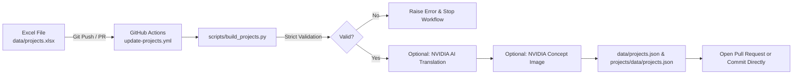

# 📊 IUS Engineering Club — Excel Data Flow and Automation System

This document explains how project data is managed through Excel (`data/projects.xlsx`), automatically validated and converted into the `projects.json` file by GitHub Actions, and enriched with NVIDIA AI services (translation and concept image generation) for missing content.

---

## 🎯 Core Flow Architecture



---

## 📑 Excel Columns and JSON Field Mapping

In the Excel template, each row represents **one project** and each column represents a data field in `projects.json`:

| Column Name (Excel) | JSON Equivalent | Type / Format | Description & Rules |
| :--- | :--- | :--- | :--- |
| `id` | `id` | Text (Slug) | **REQUIRED & UNIQUE.** Lowercase letters, digits, hyphens (`-`), and underscores (`_`) only. E.g.: `powerbank-station`. |
| `sheet_id` | `sheet_id` | Integer | Project sequence number (1, 2, 3...). |
| `is_flagship` | `is_flagship` | Boolean | `TRUE` or `FALSE`. For featured flagship projects. |
| `featured` | `featured` | Boolean | `TRUE` or `FALSE`. For the showcase listing. |
| `difficulty` | `difficulty` | Integer (1-5) | **REQUIRED.** Must be between 1 and 5. Sets the difficulty dots on the card. |
| `category_tr` | `category.tr` | Text | The project's category name in Turkish. |
| `category_en` | `category.en` | Text | The project's category name in English (can be translated by AI if empty). |
| `badge_tr` | `badge.tr` | Text | Turkish badge (e.g.: "Proje Fikri", "Önerilen Etkinlik"). |
| `badge_en` | `badge.en` | Text | English badge (e.g.: "Project Idea"). |
| `status_tr` | `status.tr` | Text | Project stage (e.g.: "Öneri", "Planlanan", "Prototip", "Aktif"). |
| `status_en` | `status.en` | Text | Project stage in English (e.g.: "Proposal"). |
| `sponsor_status` | `sponsor_status` | Text / Empty | **Restricted Value:** Can only be empty (`null`), `Sponsor Aranıyor` ("sponsor wanted"), or `Sponsor Gerekmiyor` ("no sponsor needed"). |
| `joinUrl` | `joinUrl` | URL / Empty | Application or participation link. |
| `title_tr` | `title.tr` | Text | **REQUIRED.** The project's official title in Turkish. |
| `title_en` | `title.en` | Text | The project's title in English. |
| `tagline_tr` | `tagline.tr` | Text | Short Turkish tagline / summary sentence. |
| `tagline_en` | `tagline.en` | Text | Short English tagline / summary sentence. |
| `author` | `author` | Text | Name and role of the project lead / author. |
| `ownership_tr` | `ownership.tr` | Text | Project leadership and committee information (TR). |
| `ownership_en` | `ownership.en` | Text | Project leadership and committee information (EN). |
| `target_audience_tr`| `target_audience.tr`| Text | Target audience (TR). |
| `target_audience_en`| `target_audience.en`| Text | Target audience (EN). |
| `image` | `image` | File Path / Empty| Image path (e.g.: `./assets/powerbank_station_hero.webp`). **Generated automatically with AI if empty.** |
| `image_prompt` | — | Text / Empty | Optional custom English prompt. If left empty, the AI writes one from the title/problem/solution. |
| `image_alt_tr` | `image_alt.tr` | Text / Empty | Image accessibility alt text (TR). The project title is used if empty. |
| `image_alt_en` | `image_alt.en` | Text / Empty | Image accessibility alt text (EN). The project title is used if empty. |
| `regenerate_image` | — | Boolean | If set to `TRUE`, a new image is generated even when one already exists. |
| `problem_tr` | `problem.tr` | Text | **REQUIRED.** Description of the problem the project solves (TR). |
| `problem_en` | `problem.en` | Text | Problem description (EN). |
| `solution_tr` | `solution.tr` | Text | **REQUIRED.** Proposed engineering solution (TR). |
| `solution_en` | `solution.en` | Text | Proposed engineering solution (EN). |
| `first_step_tr` | `first_step.tr` | Text | Planned first action step (TR). |
| `first_step_en` | `first_step.en` | Text | Planned first action step (EN). |
| `spec1_label_tr` | `specs[0].label.tr`| Text | 1st Technical Parameter Label (TR, e.g.: "Mimari"). |
| `spec1_label_en` | `specs[0].label.en`| Text | 1st Technical Parameter Label (EN, e.g.: "Architecture"). |
| `spec1_val_tr` | `specs[0].value.tr`| Text | 1st Technical Parameter Value (TR, e.g.: "ESP32 / IoT"). |
| `spec1_val_en` | `specs[0].value.en`| Text | 1st Technical Parameter Value (EN, e.g.: "ESP32 / IoT Controller"). |
| `spec2_label_tr..en`| `specs[1]` | Text | 2nd Technical Parameter. |
| `spec3_label_tr..en`| `specs[2]` | Text | 3rd Technical Parameter. |
| `spec4_label_tr..en`| `specs[3]` | Text | 4th Technical Parameter. |
| `links` | `links` | Text (comma-separated)| Related web links (`https://...`). |
| `palette` | `palette` | Text | Card color theme: `gothic-noir`, `cobalt-sky`, `chili-spice`, `ink-wash`, `urban-loft`. |
| `gallery` | `gallery` | Text (comma-separated)| Paths of additional gallery images. If empty, the main `image` is used. |

---

## 🛡️ Validation Rules (`build_projects.py`)

While reading the Excel file, the script checks the following strict rules and stops immediately on any violation, reporting the **row and column letter**:
1. **Required Fields:** `id`, `difficulty`, `title_tr`, `problem_tr`, `solution_tr` cannot be left empty.
2. **Difficulty Level:** Can only be the integer `1`, `2`, `3`, `4`, or `5`.
3. **Unique Slug:** Raises an error if the `id` value was already used in an earlier row.
4. **Sponsorship Status:** Accepts only empty (`null`), `"Sponsor Aranıyor"`, or `"Sponsor Gerekmiyor"` values.
5. **Data Fidelity:** Numbers and text are carried over exactly as written in Excel; empty cells are represented as `null` in JSON.

---

## 🤖 NVIDIA AI Integration

### 1. Automatic Translation Step (`NVIDIA_MODEL`)
- **Trigger:** Fields where the Turkish column (`_tr`) is filled but the English column (`_en`) is empty.
- **Safety & Accuracy:**
  - The model prompt strictly forbids adding new information, numbers, or claims, or broadening the meaning.
  - After translation, all numbers (`150`, `24`, `1.5`, etc.) and abbreviations (`IUS`, `FENS`, `RFID`, `ESP32`, etc.) in the Turkish and English text are compared.
  - If any number mismatch is detected, that field is **left untranslated** and logged as a warning in `data/translations_report.md`.
- **Fault Tolerance:** If there is no API key, the quota runs out, or the model does not respond, the run still completes successfully without an error and the English field is left empty.

### 2. Automatic Concept Image Generation (`NVIDIA_IMAGE_MODEL`)
- **Trigger:** Projects whose `image` column is empty and that have no `assets/<slug>.webp` file (or those with `regenerate_image = TRUE`).
- **Images are never regenerated for projects that already have one** (to save credits).
- **Prompt Generation:**
  - If the `image_prompt` column is empty, `NVIDIA_MODEL` writes an English image prompt from the project's title, problem, and solution (with no logos, text, brands, or human faces).
  - The fixed style suffix from `scripts/image_style.txt` is appended to the end of the generated sentence.
  - All prompts used are written to the `data/image_prompts.json` log.
- **Image Sizing:**
  - The output is converted to WebP format.
  - Hero size: `1376 x 768` WebP (`assets/<slug>.webp`).
  - Mobile thumbnail: `688 x 384` WebP (`assets/<slug>-sm.webp`).
  - `imageIsConcept: true` is added to the JSON data.

---

## 💻 Local Test Commands

```powershell
# 1. Dry run without calling any API or changing any files (Dry-Run):
python scripts/build_projects.py --dry-run

# 2. Real local build (produces only JSON without an API key):
python scripts/build_projects.py

# 3. Full test with the NVIDIA API (by defining environment variables in PowerShell):
$env:NVIDIA_API_KEY = "nvapi-..."
$env:NVIDIA_MODEL = "meta/llama-3.3-70b-instruct"
$env:NVIDIA_IMAGE_MODEL = "stabilityai/stable-diffusion-3.5-large"
python scripts/build_projects.py
```
